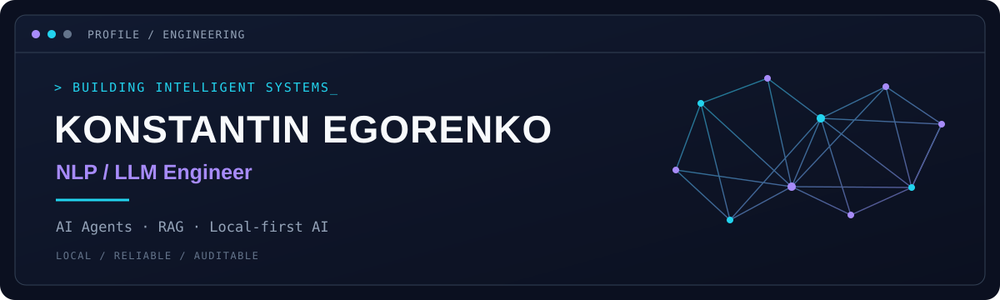

# Konstantin Egorenko

**NLP / LLM Engineer | AI Agents & RAG Systems**

Building intelligent systems, autonomous agents, retrieval pipelines, and reliable local-first AI infrastructure.

## About

- LLM applications
- Retrieval-Augmented Generation
- Semantic search and reranking
- Agent orchestration and tool execution
- Model evaluation and local inference

## Tech stack

`Python` · `PyTorch` · `Transformers` · `Hugging Face` · `SQL` ·
`Qdrant` · `PostgreSQL` · `Docker` · `Ollama` · `FastAPI`

## Featured project

### [LocalExecute — Local-first Autonomous Coding](https://github.com/KonstantinEgorenko/LocalExecute)

An experimental local-first coding agent harness focused on controlled execution, verification, durable state, and auditable task completion.

## Contact

Open to ML/LLM engineering opportunities, technical discussions and collaboration.

[Telegram — @loveisafiction](https://t.me/loveisafiction)
